# ARA Map · Exploración de diseño

20 de octubre de 2026 · base revisada: `origin/main` @ `6b20866` (Merge pull request #64 from Andre07-hash/claude/tabla-filtro-tipos-varios) · rama `claude/vigilant-galileo-s6ogeo`

Auditoría de la experiencia actual y tres direcciones de rediseño con mockups comparables. **No se implementó nada en la aplicación.** Para ver los mockups, abre [`index.html`](index.html) en el navegador (lámina comparativa) o cualquier archivo de [`mockups/`](mockups/).

Skill de referencia: `apple-design` (dickwu/apple-design-skill @ 914b6a3), con su proceso de revisión y su modo de mejora. Las citas indican el archivo y la sección de `references/hig/`. Lo que no lleva cita es criterio propio, y lo que hay que comprobar con usuarios se marca como hipótesis.

## Qué se verificó

- Leí AGENTS.md, CLAUDE.md, docs/DESARROLLO.md y README.md de la base vigente, y el código de web/ (app.js, Tabla.js, mapaPaneles.js, dialogos.js, tabla.js, tokens.css) y server/auth.py (roles y capacidades).
- Ejecuté la app local con el servidor desechable de pruebas (tests/e2e/tabla_servidor.py): SQLite temporal en el scratchpad, cuentas ficticias de administración (ada) y de operación (olga, omar).
- Sembré por la API y la interfaz 54 terrenos ficticios en 2 bases de trabajo y 2 sin asignar, 4 columnas personalizadas (opción, fecha, texto) y 11 archivos PDF/KMZ/KML, incluido un KML con 2 contornos.
- Recorrí con Chromium (Playwright) tabla, mapa, selección, detalle (⋯), edición de una celda con guardado lento simulado, selección múltiple, columnas, bases heredadas, catálogo y anchos de 1440, 1024 y 390 px, como administradora y como operadora. Las capturas están en actual/.

**Límites:**

- No toqué el sitio publicado, Render, Neon ni Supabase. Ninguna captura procede de producción.
- Los mosaicos de los mapas base no cargaron en el entorno aislado: en las capturas actuales el mapa aparece sin fondo. No evalué la legibilidad sobre Satélite.
- No probé con lector de pantalla, con teléfonos reales ni con usuarios. Las afirmaciones sobre uso son hipótesis.
- No modifiqué código funcional. Los mockups son HTML/CSS estáticos aparte de la app.

## 1. Contexto

**Hipótesis de entorno.** La computadora es el entorno principal. Lo sostienen: una tabla de 14 columnas básicas más las de cada base, edición tipo hoja de cálculo con flechas, Enter/F2, Tab y Esc (Tabla.js), el origen en Excel («Registro Análisis»), los KMZ que se producen en herramientas de escritorio, el lanzador «ARA Map.command» para macOS y unas pruebas de navegador que corren a 1500 × 900. La app ya tiene reglas responsive, pero a 390 px la cabecera y los seis controles de filtro ocupan la primera pantalla y la tabla exige desplazamiento horizontal. Supongo que en el teléfono se consulta (buscar, ubicar, abrir un PDF) y se corrige poco. Falta confirmarlo con usuarios: ¿hay visitas de campo? ¿se suben fotos JPG desde el teléfono?

**Roles (verificados en `server/auth.py` y `web/components/app.js`):**

- **Administración.** Tabla maestra (todas las bases y «Sin asignar»); crea, renombra y borra bases; concede accesos; transfiere terrenos; usa las herramientas heredadas (bases importadas, mapas guardados, formatos, importar y exportar); borra terrenos publicados.
- **Operación.** Sólo las bases que tiene concedidas. Ve, edita y borra terrenos no publicados; gestiona las columnas de su base; sube y borra archivos. No ve la tabla maestra ni las herramientas.
- **Visitante.** Catálogo público, sin datos privados.
- **Sólo lectura.** Modo de instalación (ARA_MAP_READ_ONLY): se puede leer y descargar, no escribir.

**Tareas frecuentes:** Filtrar y buscar terrenos de una base · Capturar y corregir datos celda por celda · Adjuntar PDF/JPG y KMZ/KML · Ver en el mapa la distribución por Asking $/m² · Revisar un terreno: datos, ubicación y archivos.

**Tareas delicadas:** Borrar un terreno (borra también sus archivos) · Transferir terrenos entre bases · Elegir el contorno cuando un KMZ trae varios · Resolver un conflicto de edición · No interrumpir una subida · Borrar una columna de la base o cambiar accesos.

**Tabla, mapa, filtros y ficha hoy.** Tabla / Mapa es un conmutador dentro de la misma vista. El mapa reúne todos los terrenos de la consulta, no sólo la página, y comparte la selección. Los filtros de la tabla (Buscar, Estado, Municipio, Tipo, Ordenar) acotan ese conjunto; en el mapa quedan ocultos tras «Filtros de la tabla (N)». El mapa tiene además filtros propios (superficie, Asking price, Asking $/m², «Solo con ubicación») que no llegan a la tabla y se borran al salir. La ficha del mapa es de sólo lectura. El detalle (⋯) es un diálogo modal con los datos en sólo lectura, los archivos y las acciones Historial, Transferir y Borrar. Sólo se edita en las celdas.

**Guardado hoy.** Se guarda por celda y con versión. Los estados son «guardando», «sin guardar», «en conflicto» y «sin confirmar». Una respuesta perdida se comprueba con el servidor antes de reenviar. El resultado aparece en el pie de la ventana («Guardado · Superficie · versión 3»). La app avisa antes de salir si hay cambios o subidas sin terminar.

## 2. Diagnóstico: siete oportunidades de mayor impacto

### 1. Dos sistemas de filtros que no se hablan

- **Evidencia (observado):** La tabla filtra por Buscar, Estado, Municipio, Tipo y Ordenar. El mapa tiene otro riel con Buscar, Estado, Municipio, Tipo, Superficie, Asking price, Asking $/m² y «Solo con ubicación». En el mapa, los filtros de la tabla quedan tras «Filtros de la tabla (1)», y los del mapa se borran al salir de la vista (mapaPaneles.js). Con «Apaseo» buscado en la tabla, el mapa muestra 1 terreno de 1 (captura 16).
- **Tarea afectada:** Encontrar y comparar
- **Consecuencia:** No se sabe qué conjunto está a la vista. El precio sólo se puede filtrar en el mapa, y al buscar un terreno desaparece su entorno.
- **Cambio propuesto:** Un solo modelo de filtros para todas las vistas, visible como chips y con el alcance en palabras («22 de 48 · 20 en el mapa · 2 sin ubicación»).
- Captura: [`actual/16-admin-mapa-seleccion.png`](actual/16-admin-mapa-seleccion.png)

### 2. Tres versiones del terreno y ninguna completa

- **Evidencia (observado):** La fila es editable. El detalle (⋯) es un modal con datos en sólo lectura, archivos y acciones. La ficha del mapa dice «Ficha de solo lectura. Para editar, subir, activar o retirar archivos usa la tabla» (captura 58).
- **Tarea afectada:** Revisar y corregir un terreno
- **Consecuencia:** Para corregir algo visto en el mapa hay que volver a la tabla, encontrar la fila, desplazarse a la derecha y editar la celda.
- **Cambio propuesto:** Una sola ficha editable, la misma en la tabla y en el mapa, con datos, ubicación, archivos, columnas de la base e historial.
- Captura: [`actual/58-ficha-abajo.png`](actual/58-ficha-abajo.png)

### 3. Archivos y ubicación al final de la fila

- **Evidencia (observado):** PDF y KMZ son las columnas 13 y 14, después de X e Y (capturas 11 y 12). Cada fila repite «Elegir PDF o JPG…» y «Elegir KMZ o KML…»: 96 botones en 48 filas. La tabla no dice si un terreno saldrá como punto, como contorno o no saldrá.
- **Tarea afectada:** Saber qué falta y adjuntar archivos
- **Consecuencia:** Para saber si hay PDF o contorno hay que desplazarse en horizontal. Los botones repetidos meten ruido en todas las filas.
- **Cambio propuesto:** Ubicación (forma + texto) y documentos junto al nombre. Las acciones de subida pasan a la ficha, al menú de la fila y a arrastrar el archivo.
- Captura: [`actual/12-admin-tabla-scroll-derecha.png`](actual/12-admin-tabla-scroll-derecha.png)

### 4. El estado de guardado está lejos y dura poco

- **Evidencia (observado):** «(guardando)» aparece en la celda y «Guardado · Superficie · versión 3» en el pie, a unos 600 px de la celda (capturas 52 y 53). El saludo «Hola, Ada Ficticia» tapa ese pie al entrar.
- **Tarea afectada:** Saber si lo capturado quedó guardado
- **Consecuencia:** Quien edita varias celdas seguidas no tiene un lugar fijo que le confirme que todo quedó guardado. La HIG desaconseja poner información crítica en la parte inferior de la ventana (layout.md › Desktop).
- **Cambio propuesto:** Un indicador fijo en la barra superior («Todo guardado», «Guardando 1 cambio», «1 conflicto · Revisar») además del estado de la celda.
- Captura: [`actual/53-guardado.png`](actual/53-guardado.png)

### 5. «Base» significa dos cosas

- **Evidencia (observado):** El menú «Bases» lleva a los archivos Excel heredados (vacío; captura 20), mientras las bases de trabajo están en el selector «Vista» y en «Bases y accesos». «Tabla maestra» aparece activa aunque se esté viendo una base concreta. Los encabezados mezclan «Asking price», «Asking $/m2», «HA», «X» e «Y», y algunos muestran el tipo técnico («Etapa · opcion», sin acento).
- **Tarea afectada:** Orientarse y saber dónde se está
- **Consecuencia:** La palabra principal del dominio tiene dos significados, y la navegación no dice en qué base se trabaja.
- **Cambio propuesto:** La base actual como título del espacio de trabajo, las herramientas heredadas aparte y unidades escritas igual en todas partes (m², MXN, X = latitud).
- Captura: [`actual/20-admin-bases-heredadas.png`](actual/20-admin-bases-heredadas.png)

### 6. En ancho reducido, la primera pantalla son sólo controles

- **Evidencia (observado):** A 390 px, la cabecera, seis controles de filtro y cuatro botones ocupan cerca de 560 px. La tabla aparece al final y se desplaza en horizontal (captura 40). El mapa sí se adapta con un botón «Filtros» (captura 41).
- **Tarea afectada:** Consultar un terreno desde el teléfono
- **Consecuencia:** Antes de ver un solo terreno hay que desplazarse. La tabla no se puede leer sin moverla de lado.
- **Cambio propuesto:** Renglones de dos líneas, filtros como chips y ficha a pantalla completa, con las mismas funciones (layout.md › Size classes).
- Captura: [`actual/40-movil-tabla.png`](actual/40-movil-tabla.png)

### 7. Contraste insuficiente y significados sólo de color

- **Evidencia (observado):** --ink-muted (#868280) sobre papel da 3.50:1, por debajo de 4.5:1, y se usa en 30 reglas para texto pequeño: textos de ayuda, «Sin archivos», tipo de columna y «guardando». El marcador «sin dato» #9a9892 da 2.42:1 sobre el mapa claro y el primer tono de la rampa #6da7ec, 2.10:1. Los bordes de los controles dan 1.65:1. La fila seleccionada se distingue sólo por una barra de 3 px.
- **Tarea afectada:** Leer, distinguir y ubicar la selección
- **Consecuencia:** Texto auxiliar difícil de leer, marcadores que se confunden con el fondo y una selección fácil de perder.
- **Cambio propuesto:** ink-3 #6b6764 (5.18:1), rampa desde #4384d4 (3.20:1), «sin precio» como anillo hueco #5b5754 (5.99:1), bordes de control #8d8984 (3.21:1) y la selección marcada con fondo, barra y peso.
- Captura: [`actual/14-admin-mapa.png`](actual/14-admin-mapa.png)

### Qué conviene conservar

- Edición tipo hoja de cálculo con teclado y guardado por celda con versión. Un conflicto nunca sobrescribe, y «sin confirmar» comprueba con el servidor antes de reenviar.
- El mapa reúne todo el conjunto de la consulta, no sólo la página, y la selección viaja entre Tabla y Mapa.
- La ubicación es honesta: la ficha dice si el terreno se dibuja por contorno o por X/Y, y la leyenda cuenta los que quedan fuera.
- Un dato faltante queda vacío, nunca en cero, y el precio lleva «MXN» explícito.
- El autollenado m² ⇄ HA y precio ⇄ $/m² sólo actúa sobre celdas vacías.
- Con varios contornos candidatos se elige de forma explícita, y un KMZ inválido conserva el contorno anterior.
- Las subidas en curso están protegidas y la app avisa antes de salir.
- El cromo es acromático y el color pertenece a los datos (tokens.css). Es el punto de vista del producto y las tres direcciones lo mantienen.
- La selección múltiple abarca páginas («Seleccionar los 48 terrenos de esta vista»).
- Fondos Claro, Satélite y Calles, y «Encuadrar todo».

Principios citados (leídos en la skill):

- `layout.md › Desktop (macOS)`: «Avoid placing controls or critical information at the bottom of a window.»
- `layout.md › Size classes`: «Keep functionality the same as size classes change… you can change the amount of functionality that’s visible onscreen.»
- `layout.md › Visual hierarchy`: «Use progressive disclosure to make layouts cleaner and easier to interact with.»
- `accessibility.md › Vision`: contraste mínimo de 4.5:1 para texto de hasta 17 pt; «Convey information with more than color alone.»
- `lists-and-tables.md › Desktop`: «let people click a column heading to sort a table view based on that column.»
- `searching.md › Best practices`: «Clearly display the current scope of a search.»
- `maps.md › Best practices`: «Clearly identify elements that people select.» · `maps.md › Place cards`: «Keep the location on your map visible when displaying a place card.»
- `feedback.md › Best practices`: «Consider integrating status feedback into your interface.»
- `modality.md`: «Present content modally only when there’s a clear benefit.»
- `panels.md`: el inspector «displays the details of the currently selected item, automatically updating its contents».
- `materials.md › Liquid Glass`: «Don’t use Liquid Glass in the content layer.»
- `split-views.md › Best practices`: «persistently highlight the current selection in each pane».

## 3. Vista comparativa

| | A · Hoja con ficha (Evolución) | B · Mesa dividida (Reorganización) | C · Atlas de expedientes (Exploración) |
|---|---|---|---|
| 1. Tabla o espacio principal | [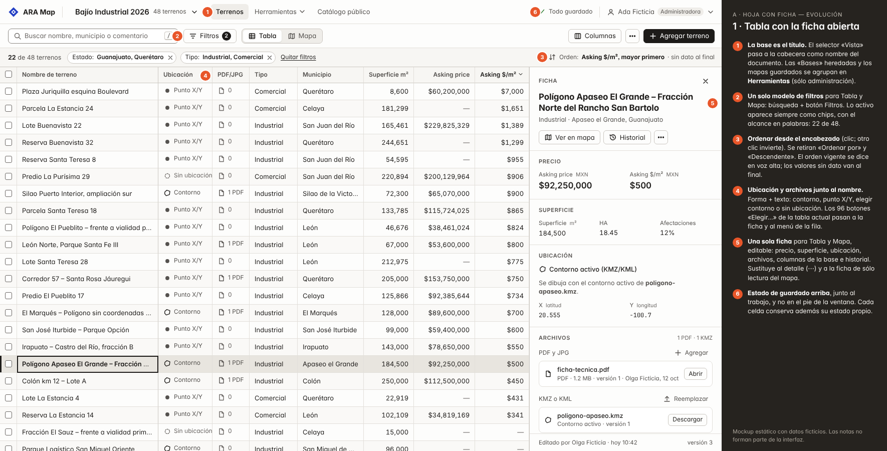](mockups/A1-tabla.html) | [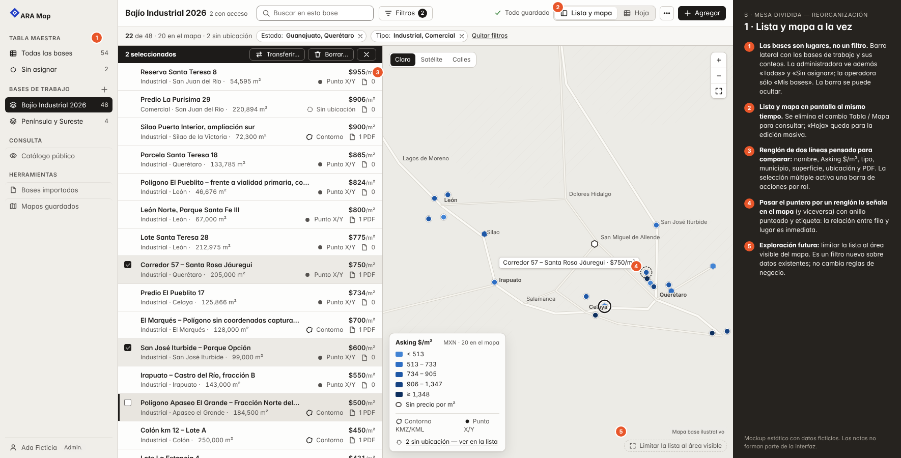](mockups/B1-lista-y-mapa.html) | [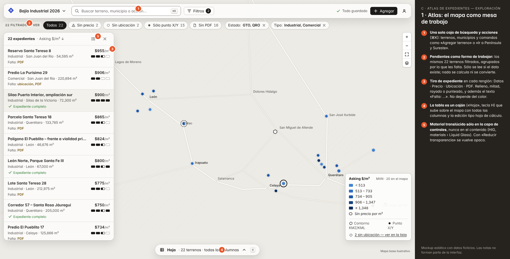](mockups/C1-atlas.html) |
| 2. Mapa con un terreno seleccionado | [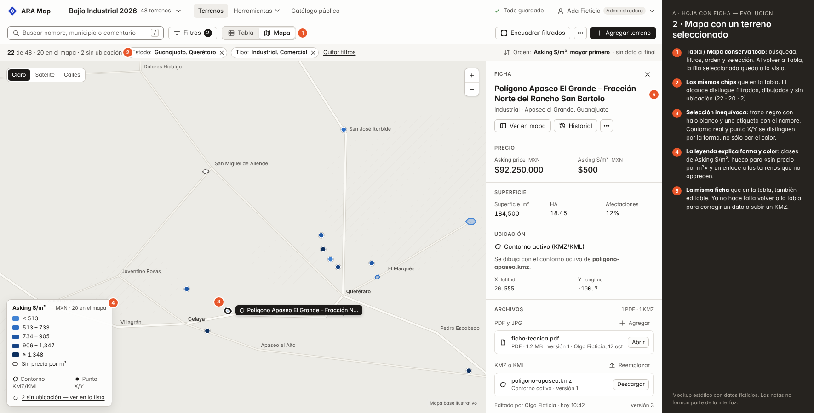](mockups/A2-mapa.html) | [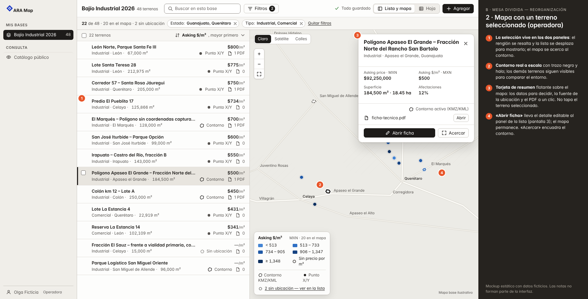](mockups/B2-mapa-seleccion.html) | [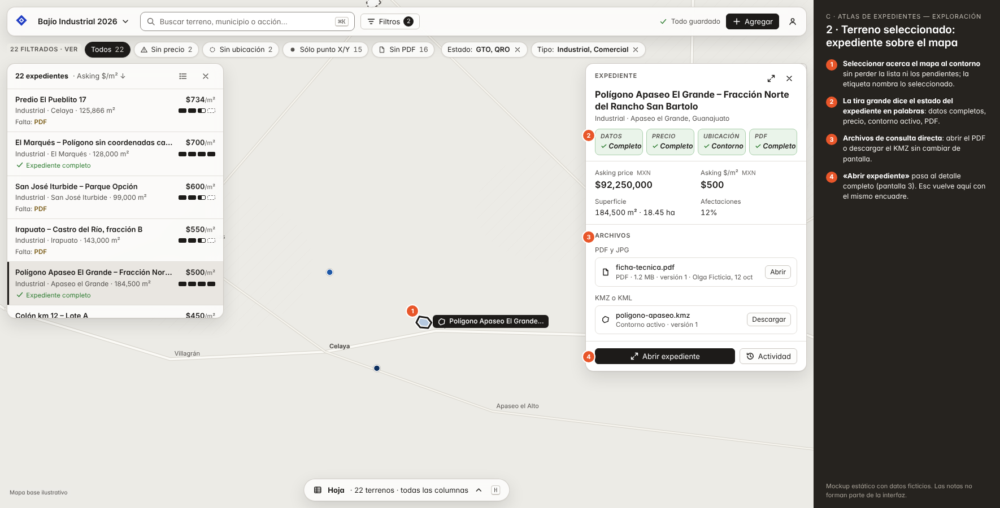](mockups/C2-expediente-mapa.html) |
| 3. Detalle y edición | [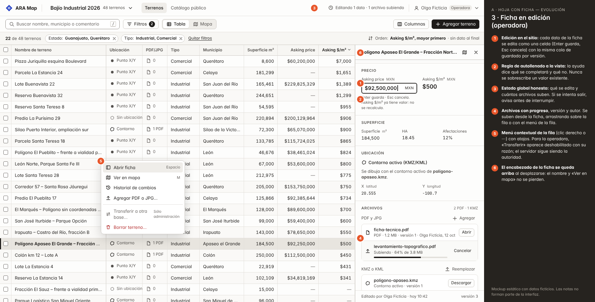](mockups/A3-ficha-edicion.html) | [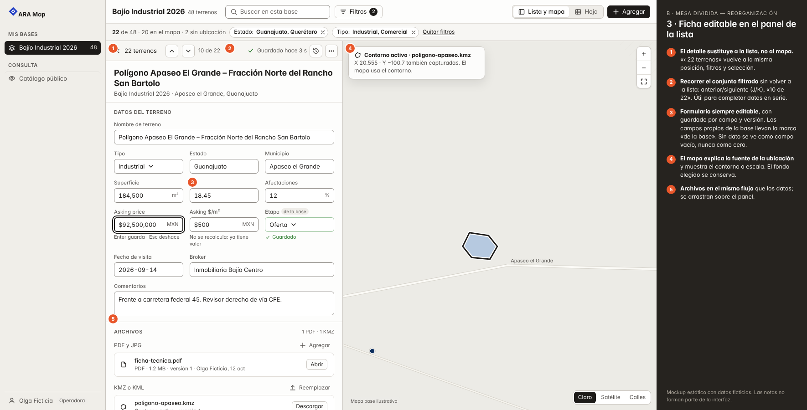](mockups/B3-ficha-edicion.html) | [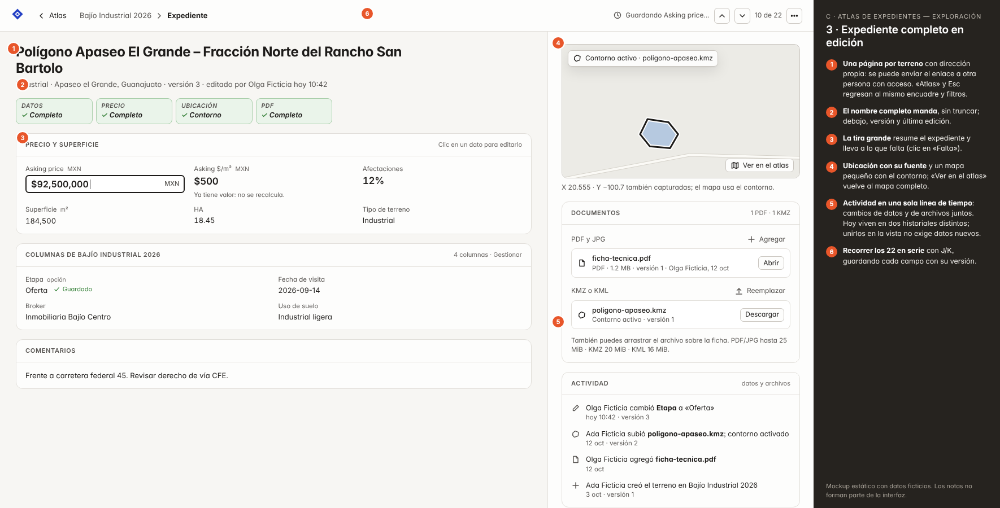](mockups/C3-expediente-pagina.html) |
| 4. Ancho reducido (390 px) | [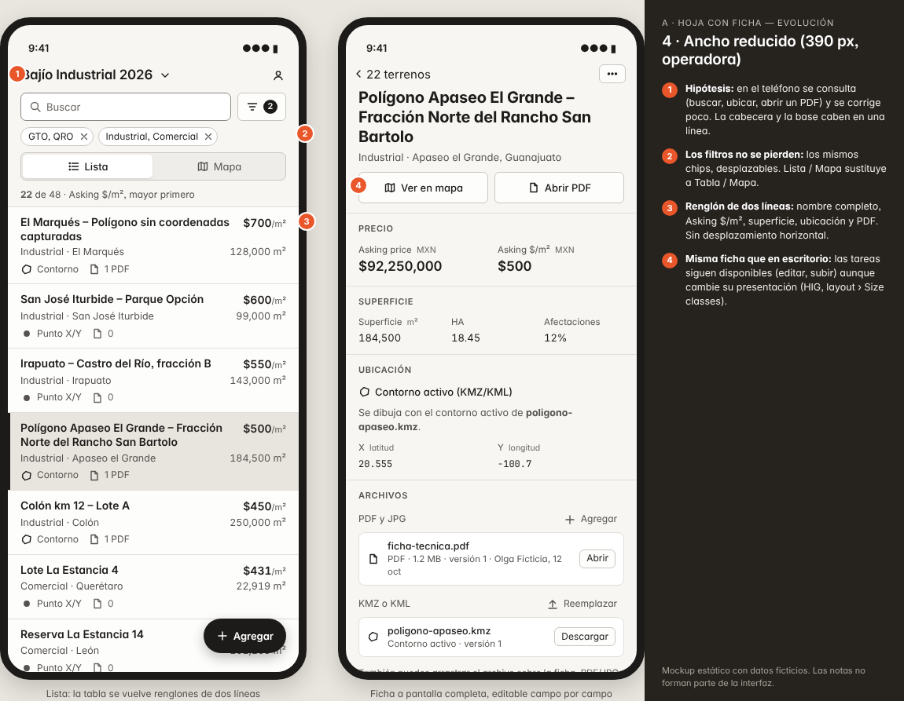](mockups/A4-estrecho.html) | [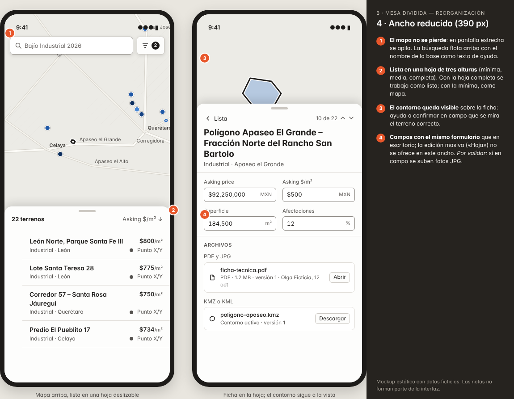](mockups/B4-estrecho.html) | [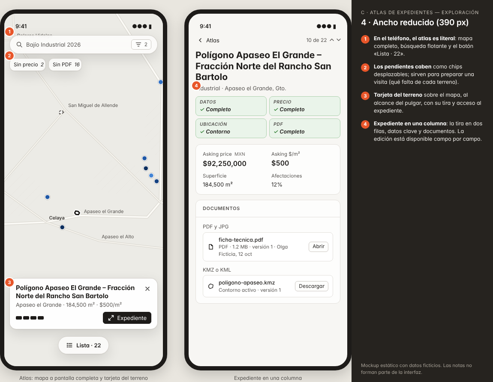](mockups/C4-estrecho.html) |
| 5. Estados complementarios | [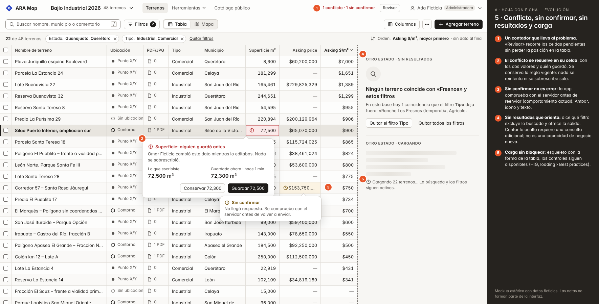](mockups/A5-estados.html) | [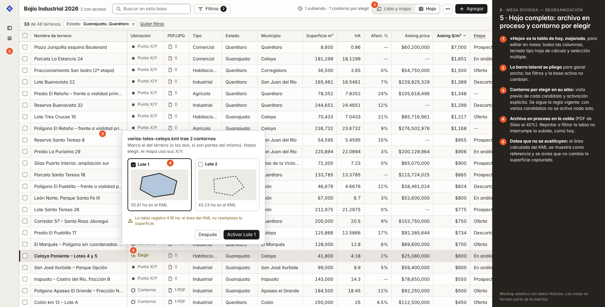](mockups/B5-hoja-archivos.html) | [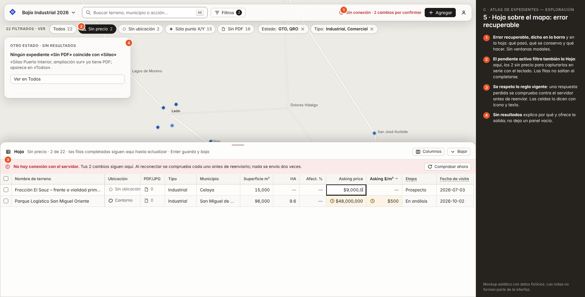](mockups/C5-hoja-error.html) |

## 4. Las tres direcciones

### A · Hoja con ficha — Evolución

**Idea central.** La tabla sigue en el centro. Una ficha lateral, única y editable, acompaña a Tabla y a Mapa, y un solo modelo de filtros sirve a las dos vistas.

- **Beneficia:** A operadoras y operadores que capturan y corrigen a diario, y a administración cuando revisa una base.
- **Organización:** Cabecera con la base como título → barra con búsqueda, Filtros, Tabla|Mapa y Agregar → chips con el alcance → tabla o mapa, con la ficha a la derecha.
- **Conserva:** La tabla, el conmutador Tabla / Mapa, la edición por celda y la selección compartida.
- **Cambia:** Los filtros (unificados y en chips), el orden (desde el encabezado), la ficha (una y editable), dónde se ven ubicación y archivos, y el estado de guardado (arriba).
- **Elimina:** El riel de filtros propio del mapa, el detalle modal (⋯), la ficha de sólo lectura, los botones «Elegir…» de cada celda y los controles «Ordenar por» y «Descendente».
- **Principal ventaja:** Casi no hay que aprender nada nuevo y se puede entregar en PRs pequeños.
- **Principal sacrificio o riesgo:** Sigue mostrando una cosa a la vez, tabla o mapa, y la ficha resta 384 px a la tabla.
- **Rasgo distintivo:** La ficha que viaja: el mismo terreno, igual y editable, en la tabla y en el mapa.

**Recorrido** (encontrar → verlo en el mapa → revisar información y archivos → volver):

1. En «Bajío Industrial 2026», Filtros → Estado: Guanajuato y Querétaro; Tipo: Industrial y Comercial. Los chips dicen «22 de 48».
2. Clic en el encabezado «Asking $/m²» para ordenar de mayor a menor. Con las flechas se llega a «Polígono Apaseo…» y Espacio abre la ficha.
3. «Ver en mapa» (M) cambia a Mapa con los mismos filtros, la misma selección y la misma ficha. El mapa se acerca al contorno y los otros 19 terrenos dibujados siguen a la vista.
4. En la ficha: «Abrir» abre ficha-tecnica.pdf en otra pestaña y «Descargar» baja el KMZ. Si hace falta, se corrige el precio ahí mismo.
5. «Tabla» (T) vuelve a la fila seleccionada, con la misma posición, el mismo orden y la ficha abierta.

*Pendiente de validar:* Validar si la ficha lateral resta demasiadas columnas en pantallas de 1280 px, si la búsqueda debe filtrar o sólo saltar al resultado y si se entiende el orden desde el encabezado.

Mockups: [A1-tabla](mockups/A1-tabla.html) · [A2-mapa](mockups/A2-mapa.html) · [A3-ficha-edicion](mockups/A3-ficha-edicion.html) · [A4-estrecho](mockups/A4-estrecho.html) · [A5-estados](mockups/A5-estados.html)

### B · Mesa dividida — Reorganización

**Idea central.** Ver y comparar en lista y mapa a la vez. Las bases son lugares en una barra lateral, y la hoja de cálculo completa pasa a un modo «Hoja» para la edición masiva.

- **Beneficia:** A quien analiza y selecciona terrenos comparando precio y ubicación, y a administración cuando salta entre bases.
- **Organización:** Barra lateral con las bases → lista de dos líneas (520 px) y mapa. Una tarjeta de resumen aparece sobre el mapa y la ficha editable se abre en el panel de la lista.
- **Conserva:** La tabla completa (como «Hoja»), la edición por campo con versión y la selección múltiple.
- **Cambia:** La navegación (barra lateral), la lista y el mapa simultáneos, y la ficha como formulario con anterior/siguiente.
- **Elimina:** El conmutador Tabla / Mapa para consultar y el selector «Vista».
- **Principal ventaja:** La relación entre fila y lugar es inmediata, y se edita sin perder el contexto espacial.
- **Principal sacrificio o riesgo:** Hay dos modos que aprender (Lista y mapa / Hoja). La lista muestra 6 datos, no 14, y la disposición necesita 1280 px o más.
- **Rasgo distintivo:** El resaltado cruzado: al pasar por un renglón se señala su marcador, y al revés.

**Recorrido** (encontrar → verlo en el mapa → revisar información y archivos → volver):

1. Barra lateral → «Bajío Industrial 2026». Se aplican los filtros con chips; la lista y el mapa muestran los mismos 22.
2. Al pasar el puntero por los renglones se señalan los marcadores. Un clic en «Polígono Apaseo…» lo selecciona, el mapa se acerca y aparece la tarjeta.
3. En la tarjeta: Asking price, $/m², superficie, la fuente de la ubicación y «Abrir» para el PDF, sin cambiar de pantalla.
4. «Abrir ficha» lleva el formulario al panel de la lista mientras el mapa sigue mostrando el contorno. Se corrige un dato y J pasa al siguiente terreno.
5. «‹ 22 terrenos» regresa a la lista, en la misma posición y con los mismos filtros y selección.

*Pendiente de validar:* Validar si 6 datos por renglón bastan para decidir, si el ancho mínimo (1280 px) cubre los equipos reales y si «Hoja» se descubre cuando hace falta editar en masa.

Mockups: [B1-lista-y-mapa](mockups/B1-lista-y-mapa.html) · [B2-mapa-seleccion](mockups/B2-mapa-seleccion.html) · [B3-ficha-edicion](mockups/B3-ficha-edicion.html) · [B4-estrecho](mockups/B4-estrecho.html) · [B5-hoja-archivos](mockups/B5-hoja-archivos.html)

### C · Atlas de expedientes — Exploración

**Idea central.** El mapa es la mesa de trabajo. Cada terreno es un expediente con su estado de completitud (datos, precio, ubicación y PDF), y el trabajo se organiza por lo que falta.

- **Beneficia:** A quien completa el inventario o prepara visitas, y a la consulta desde el teléfono.
- **Organización:** Mapa a pantalla completa con controles flotantes → panel de expedientes con la tira de completitud → tarjeta → página del expediente. La Hoja es un cajón que sube sobre el mapa.
- **Conserva:** La Hoja (como cajón), la edición con versión y todas las reglas de ubicación.
- **Cambia:** El punto de entrada (el mapa), los «pendientes» como filtros predefinidos, el expediente con su actividad unificada y la búsqueda con comandos ⌘K.
- **Elimina:** La tabla como pantalla inicial.
- **Principal ventaja:** Hace visible el trabajo pendiente y le da a ARA una identidad cartográfica propia.
- **Principal sacrificio o riesgo:** Es la de mayor curva de aprendizaje y costo. Quien captura en masa puede sentir la tabla como secundaria. Las capas translúcidas sobre Leaflet exigen cuidar contraste y rendimiento, y hacen falta consultas nuevas: pendientes del lado del servidor por encima de 5000 terrenos e historiales unidos.
- **Rasgo distintivo:** La tira de expediente: Datos · Precio · Ubicación · PDF.

**Recorrido** (encontrar → verlo en el mapa → revisar información y archivos → volver):

1. ⌘K → «Apaseo» → Enter selecciona el terreno y acerca el mapa sin quitar de la vista a los demás.
2. La tarjeta del expediente muestra la tira (todo completo), los datos clave y los archivos («Abrir» para el PDF).
3. «Abrir expediente» lleva a la página del terreno, con su mapa pequeño, documentos y actividad. Ahí se corrige el precio.
4. Esc o «Atlas» vuelve al mismo encuadre, con los mismos pendientes y filtros. J/K recorre los 22 sin salir del expediente.
5. Para capturar en serie: «Sin precio» → H abre la Hoja con esos 2 terrenos.

*Pendiente de validar:* Validar si se entiende el concepto de «pendientes», el rendimiento y la legibilidad de las capas translúcidas sobre Satélite, si el cajón Hoja basta para la captura masiva y si el atlas sirve de verdad en el teléfono.

Mockups: [C1-atlas](mockups/C1-atlas.html) · [C2-expediente-mapa](mockups/C2-expediente-mapa.html) · [C3-expediente-pagina](mockups/C3-expediente-pagina.html) · [C4-estrecho](mockups/C4-estrecho.html) · [C5-hoja-error](mockups/C5-hoja-error.html)

## 5. Comparación cualitativa

| Criterio | A · Hoja con ficha | B · Mesa dividida | C · Atlas de expedientes |
|---|---|---|---|
| Claridad | Alta. Cada cosa tiene un lugar y se nombra igual en todas partes. | Alta para comparar y media para editar, porque hay dos modos. | Alta sobre qué falta; menor sobre dónde está la tabla. |
| Esfuerzo en tareas frecuentes | Corregir desde el mapa ya no exige cambiar de vista. La captura masiva sigue igual. | Comparar cuesta lo mínimo. Editar en masa obliga a pasar a «Hoja». | Completar pendientes cuesta lo mínimo. Capturar en masa obliga a abrir el cajón. |
| Continuidad entre vistas | Filtros, selección y ficha idénticos en Tabla y Mapa. | No hay cambio de vista para consultar. La ficha abre sin quitar el mapa. | El mapa es permanente y el expediente tiene dirección propia. |
| Densidad útil (1440 × 900) | La mayor: unas 21 filas y 9 columnas con la ficha abierta. | 14 renglones con 6 datos cada uno, más el mapa. | 9 renglones con 5 datos y su estado. La Hoja completa, bajo demanda. |
| Accesibilidad prevista | Mismos tokens y sin translucidez. Tabla con navegación por teclado. | Mismos tokens. Exige una ruta de teclado clara entre la lista y el mapa. | Necesita un modo opaco con «Reducir transparencia» y medir el contraste sobre Satélite. |
| Curva de aprendizaje | Baja. | Media. | Alta. |
| Complejidad de implementación | Media. Reutiliza Tabla.js, la cola de guardado y mapaPaneles. Lo más difícil es unificar los filtros: hoy los rangos de precio y superficie sólo filtran el mapa. | Media-alta. Disposición nueva, lista virtualizada, resaltado sincronizado y Leaflet en un panel redimensionable. | Alta. Otro punto de entrada, cajón, rutas de expediente, pendientes, historial unificado y ⌘K. |

Sin puntuaciones: las diferencias se explican con observaciones y razonamiento, no con números inventados.

## 6. Recomendación

**A · Hoja con ficha, con tres rescates.**

- El trabajo diario de ARA es capturar y corregir en tabla. Así nació (Excel) y así está construida la edición por teclado. A resuelve las fricciones que más pesan (filtros, ficha, archivos, guardado y contraste) sin quitar ese modelo mental.
- Se puede entregar en PRs pequeños e independientes, como pide AGENTS.md, y cada paso deja la app mejor que antes.
- Ninguna de sus piezas depende de una capacidad de negocio nueva.

**Elementos rescatables de las otras direcciones:**

- De B: anterior/siguiente (J/K) en la ficha para recorrer el conjunto filtrado, y elegir contorno con vista previa de cada candidato (B5).
- De C: los «pendientes» como filtros predefinidos dentro del mismo modelo de filtros (Sin precio, Sin ubicación, Sólo punto X/Y, Sin PDF), y la tira de expediente como columna opcional.
- De B, como exploración: una tercera opción «Tabla + mapa» en el conmutador para pantallas de 1600 px o más.

**Riesgos:**

- La ficha de 384 px reduce las columnas visibles. Debe poder cerrarse y cambiar de ancho, y la app debe recordar las columnas elegidas.
- Para unificar los filtros hay que decidir si los rangos (precio, superficie) se aplican en el servidor o sobre el conjunto reunido, como hoy en el mapa.
- Editar desde la ficha suma una segunda superficie de edición. Debe usar la misma cola por terreno y los mismos estados de celda.

**Orden sugerido si más adelante se autoriza implementar** (un PR por paso; esta tarea no lo autoriza):

1. Contraste y tokens (bajo riesgo, sin cambiar la disposición)
2. Estado de guardado en la barra superior
3. Columnas Ubicación y PDF junto al nombre, y menú de la fila
4. Ficha única, primero de lectura, en tabla y mapa
5. Edición desde la ficha
6. Filtros unificados con chips
7. Renglones de dos líneas en ancho reducido

## 7. Accesibilidad, teclado y comportamiento responsive

Contraste medido con la fórmula de WCAG 2.x sobre los valores hexadecimales de los mockups:

| Par | Contraste |
|---|---|
| Texto principal --ink #1d1b19 / papel #f7f6f3 | 15.89:1 |
| Texto secundario --ink-2 #55524f / papel | 7.18:1 |
| Texto auxiliar --ink-3 #6b6764 / papel (hoy #868280: 3.50:1) | 5.18:1 |
| --ink-3 / fondo de fila seleccionada #e8e5df | 4.46:1 → usar --ink-2 en filas seleccionadas |
| Error #b42f2f / #fbeaea | 5.33:1 |
| Aviso #7a5b16 / #fbf3e3 | 5.71:1 |
| Correcto #2f7d32 / #eaf4ea | 4.54:1 |
| Blanco / botón principal #1d1b19 | 17.17:1 |
| Primer tono de la rampa #4384d4 / mapa claro #ecebe6 (hoy #6da7ec: 2.10:1) | 3.20:1 |
| Anillo «sin precio» #5b5754 / mapa claro (hoy #9a9892: 2.42:1) | 5.99:1 |
| Borde de controles #8d8984 / #fdfdfc (hoy 1.65:1) | 3.21:1 |

- **Foco.** El foco es un anillo de 2 px en --ink con un halo blanco de 3 px, visible sobre papel y sobre Satélite. En la tabla, la celda enfocada lleva un contorno interior de 2 px. El outline nunca se quita. El orden de Tab es cabecera → barra → chips → contenido → ficha, y se conserva «Saltar al contenido».
- **Teclado.** Atajos: / buscar · T/M Tabla o Mapa (A) · flechas, Enter/F2 y Esc en la tabla (como hoy) · Espacio abre la ficha · J/K siguiente y anterior · Esc cierra la ficha · ⌘K comandos y H Hoja (C). Los atajos de una letra no actúan dentro de un campo de texto y se pueden desactivar (WCAG 2.1.4).
- **Lector de pantalla.** La tabla es un grid ARIA con aria-rowcount y aria-rowindex. La ficha es una región con nombre. Los marcadores tienen nombre accesible y la lista ofrece una alternativa al mapa. El guardado se anuncia con aria-live («Guardado: Superficie»).
- **Movimiento y transparencia.** Transiciones de 200 ms o menos que respetan prefers-reduced-motion (ya existe en tokens.css). En C, las capas translúcidas pasan a opacas con prefers-reduced-transparency o sin soporte de backdrop-filter.
- **Tamaños.** Cuerpo de 13 px (el predeterminado de macOS, HIG typography). Mínimo de 11 px, sólo en etiquetas en mayúsculas. Controles de 28 px de alto en escritorio (HIG accessibility: 28 × 28 pt) y de 40 a 44 px en táctil. Con zoom del 200 % la ficha pasa a pantalla completa.
- **Responsive.** A partir de 1280 px, la disposición completa. Entre 1024 y 1279 px, la ficha se superpone en lugar de quedar al lado (A) y la lista y el mapa se reparten al 50 % (B). Por debajo de 768 px, renglones y ficha a pantalla completa (A), mapa con hoja deslizable (B) o atlas (C).

> Son especificaciones de diseño. Un mockup estático no demuestra accesibilidad funcional; eso se verifica en el prototipo y en la implementación.

## 8. Autocrítica aplicada antes de entregar

- Las marcas numeradas tapaban texto: se movieron a los márgenes de cada elemento.
- En A, la columna por la que se ordena quedaba oculta tras la ficha. Se reordenaron y ajustaron los anchos para que «Asking $/m²» siempre quede a la vista.
- En A3, el menú «⋯» tapaba el campo que se estaba editando. Pasó a ser un menú contextual de la fila, y la ficha conserva su encabezado al desplazarse.
- En B3, el fondo «Satélite» aparecía marcado sobre un mapa claro. Se corrigió para no afirmar algo que la imagen no muestra.
- En B5, el terreno con dos contornos quedaba fuera de los filtros del escenario. Ese estado usa ahora su propio filtro, y lo dice.
- En C, la tira grande en bloques negros dominaba la pantalla y se desbordaba. Pasó a un tono suave con texto y marca ✓, y se cuenta con la misma rejilla en cualquier ancho.
- La nota de C5 decía «4 sin precio» cuando el conjunto tenía 2. Ahora los conteos salen de los datos, no del texto.
- ¿Podría pertenecer a cualquier dashboard? La respuesta está en lo que se conserva y se refuerza: el cromo acromático con el color reservado al precio por m², la forma que distingue un contorno de un punto X/Y, «sin dato» distinto de cero y los X/Y nombrados como latitud y longitud. C añade la tira de expediente, propia de un inventario de terrenos.

## 9. Decisiones que necesito

1. ¿Qué dirección refinamos? ¿A con los rescates propuestos u otra combinación?
2. Vocabulario: ¿conservamos «Asking price» y «Asking $/m²» del Excel del equipo o pasamos a «Precio» y «Precio por m²»? ¿«HA» o «Hectáreas»? ¿Escribimos «X (latitud)» e «Y (longitud)» en los encabezados?
3. Filtros: ¿los rangos de precio y superficie deben filtrar también la tabla? Hoy sólo filtran el mapa, y cambiarlo afecta al servidor o a cómo se reúne el conjunto.
4. Búsqueda: ¿debe filtrar, como hoy, o saltar al terreno y dejar el resto a la vista?
5. Teléfono: ¿quién lo usa y para qué? ¿Hay visitas de campo? ¿Se suben fotos JPG desde el teléfono?
6. ¿Siguen en uso las herramientas heredadas (bases importadas, mapas guardados, formatos)? Si no, se pueden ocultar más.
7. ¿Podemos hacer una sesión de 30 minutos con una operadora y una administradora sobre un prototipo navegable?
8. ¿Se mantiene sólo el modo claro? tokens.css lo decidió por la legibilidad del mapa; ninguna propuesta lo cambia.

## 10. Archivos

| Ruta | Contenido |
|---|---|
| `index.html` | Lámina comparativa: diagnóstico, las tres direcciones lado a lado, comparación y recomendación |
| `mockups/*.html` | Los 15 mockups (5 por dirección) en HTML/CSS estático; se abren sin servidor |
| `capturas/*.png` | Render de cada mockup con sus notas numeradas |
| `actual/*.png` | Capturas del producto actual con datos ficticios en un entorno local aislado |
| `fuente/` | Generador de los mockups y de este informe (`node generar.mjs --png`, `node informe.mjs`) y datos ficticios |

Los mockups no tienen interacciones: son estáticos. Las notas de la columna oscura no forman parte de la interfaz.
